<!-- ═══════════════════════════════════════════════════════════════
     PROFILE README — Fityora Office
     Repo: fityoraoffice/fityoraoffice
     ═══════════════════════════════════════════════════════════════ -->

<div align="center">

<!-- Avatar lokal (path relatif ke folder assets) -->


<h1>Fityora Office</h1>
<p><b>Fullstack Developer · Open Source Enthusiast</b></p>


<p>
  <a href="mailto:cahyostoreoffice@gmail.com"></a>
  <a href="https://instagram.com/fityoraa"></a>
  <a href="https://t.me/fityoraa"></a>
  <a href="https://wa.me/628139525985"></a>
</p>

</div>

---

## 👋 About

```typescript
const fityora = {
  role: "Fullstack Developer",
  location: "Indonesia 🇮🇩",
  focus: ["Web Development", "Open Source", "Clean Architecture"],
  learning: ["Rust", "System Design", "AI Integration"],
  open_for: "Freelance · Collaboration · Full-time"
};
```

- 🔭 Building **myprofile & fityoraoffice** — portofolio pribadi
- 🌱 Learning **Rust, System Design, AI Integration**
- 💬 Ask me about **JavaScript, TypeScript, React, Node.js**

---

## 🛠️ Tech Stack

<div align="center">

</div>

---

## 🚀 Selected Work

<div align="center">

<a href="https://github.com/fityoraoffice/myprofile">
  
</a>
<a href="https://github.com/fityoraoffice/fityoraoffice">
  
</a>

</div>

---

## 📊 Stats

<div align="center">

<!-- GitHub Stats Extended (penerus resmi yang lebih stabil) -->


</div>

---

## 🐍 Snake

<div align="center">
<picture>
  <source media="(prefers-color-scheme: dark)" srcset="https://raw.githubusercontent.com/fityoraoffice/fityoraoffice/output/snake-dark.svg" />
  <source media="(prefers-color-scheme: light)" srcset="https://raw.githubusercontent.com/fityoraoffice/fityoraoffice/output/snake.svg" />
  
</picture>
</div>

---

## 🧊 3D Contribution

<div align="center">

</div>

---

<div align="center">

### 💡 "Talk is cheap. Show me the code." — Linus Torvalds

⭐️ From [fityoraoffice](https://github.com/fityoraoffice)


</div>
