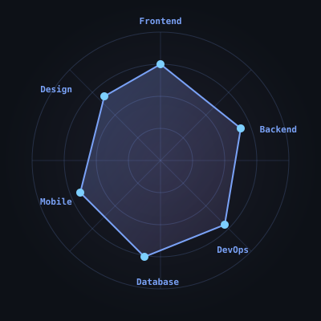

<!-- ═══════════════════════════════════════════════════════════════
     PROFILE README — Fityora Office 
     Repo: fityoraoffice/fityoraoffice
     ═══════════════════════════════════════════════════════════════ -->


<div align="center">


<p>
  <a href="mailto:cahyostoreoffice@gmail.com"></a>
  <a href="https://instagram.com/fityoraa"></a>
  <a href="https://t.me/fityoraa"></a>
  <a href="https://wa.me/628139525985"></a>
</p>

<p>
  
  
  
  
</p>

</div>

---

## 👋 About Me

```typescript
const fityora = {
  name: "Fityora Office",
  role: "Fullstack Developer",
  location: "Indonesia 🇮🇩",
  focus: ["Web Development", "Open Source", "Clean Architecture"],
  learning: ["Rust", "System Design", "AI Integration"],
  open_for: "Freelance · Collaboration · Full-time",
  funFact: "I debug with console.log and I'm not ashamed 😄"
};
```

- 🔭 Building **myprofile & fityoraoffice** — portofolio pribadi
- 🌱 Learning **Rust, System Design, AI Integration**
- 💬 Ask me about **JavaScript, TypeScript, React, Node.js**
- ⚡ **Good code is like a good joke — it needs no explanation**

---

## 🛠️ Tech Stack

<div align="center">

</div>

---

## 🎯 Tech Radar

<div align="center">

</div>

---

## 🚀 My Projects

<!-- PROJECTS-START -->
_Akan diisi otomatis oleh workflow `auto-projects.yml` setelah jalan pertama kali._
<!-- PROJECTS-END -->

---

## 📊 GitHub Stats

<div align="center">


</div>

---

## 🏆 Achievements

<div align="center">


</div>

---

## 🐍 Contribution Snake

<div align="center">
<picture>
  <source media="(prefers-color-scheme: dark)" srcset="https://raw.githubusercontent.com/fityoraoffice/fityoraoffice/output/snake-dark.svg" />
  <source media="(prefers-color-scheme: light)" srcset="https://raw.githubusercontent.com/fityoraoffice/fityoraoffice/output/snake.svg" />
  
</picture>
</div>

---

## 🧊 3D Contribution Graph

<div align="center">

</div>

---

<details>
<summary><b>💬 Guestbook — tinggalkan pesan! (klik untuk buka)</b></summary>

<br/>

<div align="center">
<p>Punya pertanyaan, saran, atau mau ngobrol? Tinggalkan pesan di discussion di bawah 👇</p>
<a href="https://github.com/fityoraoffice/fityoraoffice/discussions">
  
</a>
</div>

</details>

---

<details>
<summary><b>💻 WakaTime Stats (klik untuk buka)</b></summary>

<br/>

<!--START_SECTION:waka-->
_Data muncul setelah workflow `waka.yml` jalan._
<!--END_SECTION:waka-->

</details>

---

<details>
<summary><b>📝 Latest Blog Posts (klik untuk buka)</b></summary>

<br/>

<!-- BLOG-POST-LIST:START -->
_Artikel muncul setelah workflow `blog-posts.yml` jalan._
<!-- BLOG-POST-LIST:END -->

</details>

---

## 🤝 Let's Connect

<div align="center">

<a href="mailto:cahyostoreoffice@gmail.com">
  
</a>
<a href="https://instagram.com/fityoraa">
  
</a>
<a href="https://t.me/fityoraa">
  
</a>
<a href="https://wa.me/628139525985">
  
</a>
<a href="https://github.com/fityoraoffice">
  
</a>

</div>

---

<div align="center">

### 💡 "Talk is cheap. Show me the code." — Linus Torvalds

⭐️ From [fityoraoffice](https://github.com/fityoraoffice)


</div>
